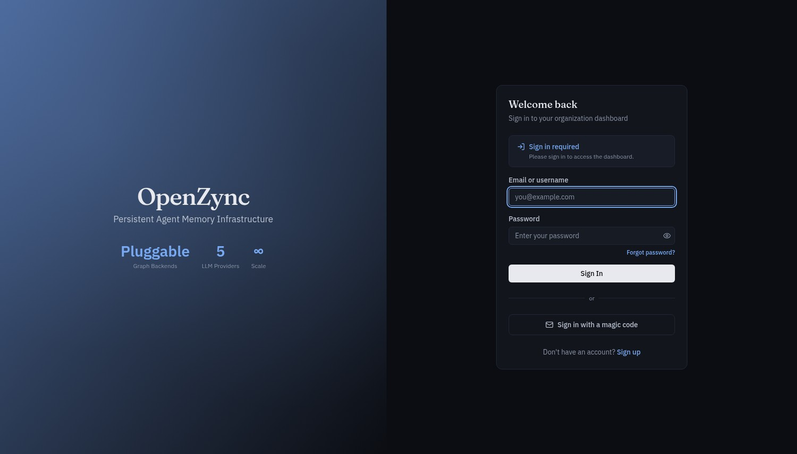

<p align="center"></p>

# OpenZync Frontend

Admin dashboard for the OpenZync agent memory platform.

<p align="center">
  <a href="./LICENSE"></a>
  
</p>

Next.js App Router dashboard for the OpenZync API: graph visualization, tenant administration, and system configuration. Product documentation lives at [docs.openzync.tech](https://docs.openzync.tech/en/latest/).

[Docs](https://docs.openzync.tech/en/latest/) · [Live app](https://app.openzync.tech) · [GitHub org](https://github.com/openzync) · [Contact](mailto:rohnsha0@gmail.com)

## Screenshots

<p align="center"></p>

*Graph Explorer with 31 nodes and 70 edges; one detected community outlined, entities colored by type.*

<p align="center"></p>

*Sign-in to an organization dashboard by password or emailed magic code.*

## Features

- **Knowledge graph visualization**: D3.js force-directed graph over entities, relationships, and communities
- **Memory browser**: inspect and search ingested episodes, facts, and classifications
- **Tenant management**: organizations, projects, and API keys
- **Session viewer**: browse conversation sessions and message history
- **System configuration**: LLM providers, rate limits, and webhooks
- **Command palette**: cmdk-driven navigation
- **Themes**: dark and light via next-themes, following the system preference

## Tech stack

| Layer | Technology |
|---|---|
| Framework | Next.js 16.2.9 (App Router), React 19.2 |
| UI | Radix UI primitives, Tailwind CSS 4, class-variance-authority |
| Graph | D3.js 7 |
| Icons and toasts | Lucide React, sonner |

## Getting started

```bash
npm install
npm run dev
```

Open `http://localhost:3000`. The dashboard calls `NEXT_PUBLIC_API_URL`, which defaults to `http://localhost:8000`. The API client is hand-written in `src/lib/api-client.ts` and there is no generation step. `npm run lint` and `npm test` (Vitest) run without a backend.

## Build and deploy

```bash
npm run build
npm start
```

The Docker image is public:

```bash
docker pull ghcr.io/openzync/frontend:latest
docker run -p 3000:3000 ghcr.io/openzync/frontend:latest
```

`NEXT_PUBLIC_*` values are inlined at build time, so the API URL is a build arg, not a runtime environment variable. The image's default is empty, which keeps requests relative for a reverse proxy that routes `/v1/*` to the API:

```bash
docker build --build-arg NEXT_PUBLIC_API_URL=https://app.openzync.tech -t openzync-frontend .
```

## Related repositories

- [openzync-core](https://github.com/openzync/openzync-core): the API this dashboard talks to
- [openzync-docs](https://github.com/openzync/openzync-docs): source of [docs.openzync.tech](https://docs.openzync.tech/en/latest/)
- [openzync-landing](https://github.com/openzync/openzync-landing): marketing site at [openzync.tech](https://openzync.tech)

## License

MIT — see [LICENSE](./LICENSE). Contributions follow the org-wide [contributing guide](https://github.com/openzync/.github/blob/main/CONTRIBUTING.md).

If this dashboard is useful to you, star the repo so other people building agent memory can find it.
